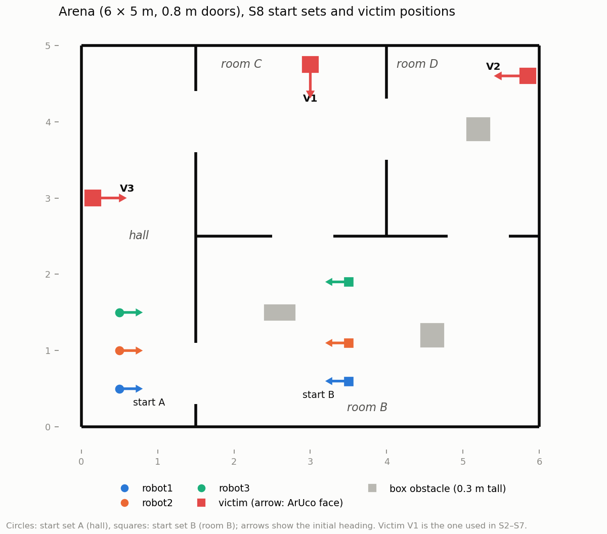

# Multirover

ROS 2 simulation and experimental results for multi-robot exploration and victim
detection in an indoor search-and-rescue scenario. The experiments compare
independent exploration, nearest-frontier allocation, greedy allocation, and
Hungarian assignment with one to three robots. Victim detection uses ArUco markers
or a YOLO person detector.

## Main results

In the recorded 6 × 5 m arena, mean exploration time with greedy coordination
fell from 99.2 s for one robot to 64.4 s for two and 47.0 s for three. Independent
exploration took 87.8 s, 115.1 s, and 132.2 s respectively. The primary campaign
contains 110 trials; the complementary YOLO campaign contains 40.

The project integrates per-robot localization, SLAM and navigation with centralized
map merging, frontier allocation, victim detection, and paired experiment analysis.
The scope is simulation in one arena, with up to three robots; it does not establish
performance on physical robots or in damaged buildings.

## Repository contents

- `src/`: ROS packages, robot description, simulation worlds, navigation,
  exploration, perception, and experiment runner.
- `results/`: per-run measurements, maps, configurations, and summaries.
  `results/excluded/` preserves invalid runs and explains their exclusion.
- `result/`: analysis scripts, validation scripts, tables, and figures.
- `result/setup/`: recorded software versions and experiment configurations.



For verification, see the [reproduction guide](REPRODUCIBILITY.md) and
[comparison with the submitted paper](VERIFICATION.md).

Start with [the results and limitations](result/README.md) and
[the reproduction commands](result/setup/README.md).

## Build and run

The recorded environment uses Ubuntu 24.04, ROS 2 Jazzy, and Gazebo Harmonic.
Install ROS 2 and initialize rosdep before running these commands from the
repository root:

```bash
source /opt/ros/jazzy/setup.bash
rosdep install --from-paths src --ignore-src -r -y
colcon build --symlink-install
source install/setup.bash
export ROS_DOMAIN_ID=42
export RMW_IMPLEMENTATION=rmw_cyclonedds_cpp
export CYCLONEDDS_URI="file://$PWD/src/mrs_bringup/config/cyclonedds_local.xml"
ros2 launch mrs_exploration sim_multi_robot.launch.py n:=2 strategy:=greedy
```

To run the experiment campaign:

```bash
ros2 run mrs_experiments run_campaign.py --dry-run
ros2 run mrs_experiments run_campaign.py
```

The campaign runner cleans up matching simulation and ROS processes between
trials; use a dedicated simulation session. It writes new runs into `results/`
and skips trials that already have summaries. Preserve the published dataset
before starting a new campaign.

## Analyze the published data

```bash
python3 -m venv --system-site-packages .venv
.venv/bin/python -m pip install -c venv_constraints.txt numpy scipy matplotlib pyyaml
.venv/bin/python result/make_result.py
```

For YOLO experiments, also install `ultralytics` with `venv_constraints.txt`.
See `src/mrs_perception/config/yolo.yaml` for detector settings.

The repository includes extracted data, localization summaries, and figures.
All 175 original compressed ROS bags and their metadata are available as a
[separate dataset download](datasets/README.md) (about 1.4 GB).
Recomputing localization errors and their time-series figure requires that dataset
and ROS 2 with rosbag2 MCAP/zstd support. Runtime logs are omitted.
Paper drafts, conference submissions, and presentation materials are not included.

## Third-party components

`src/m-explore-ros2/` contains the locally patched source of
[m-explore-ros2](https://github.com/robo-friends/m-explore-ros2), based on commit
`326cf8a0b487c34246bb8f3326afbcd69576dc60`. Its license is retained, and local
patches are recorded in `src/mrs_exploration/explore_lite_patches.patch`.

The victim-person model derives from Open Robotics' “Rescue Randy Sitting”
(CC0 1.0); attribution is retained in its model configuration and generation
script. Existing package licenses remain in their respective directories.
