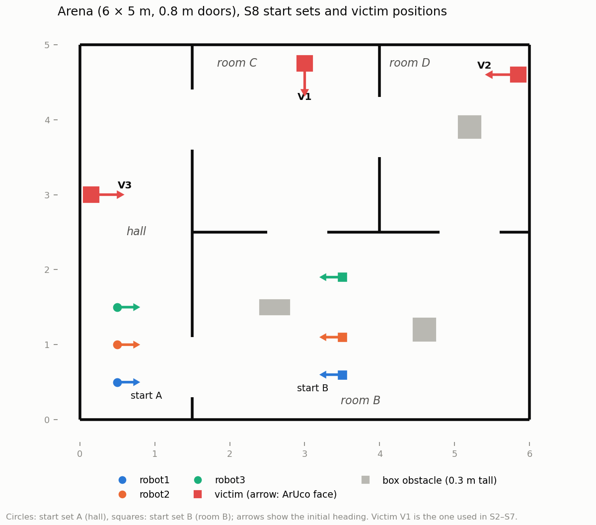
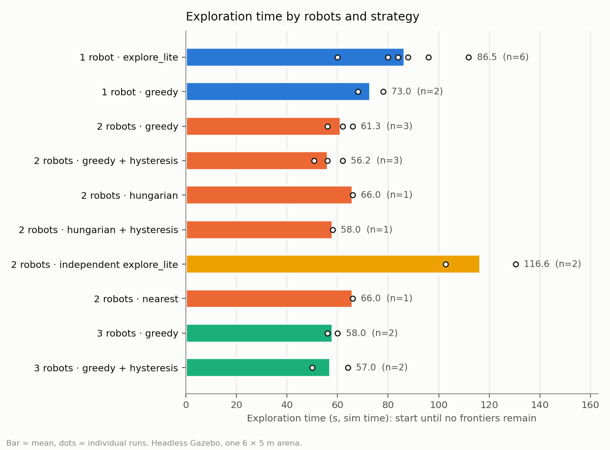
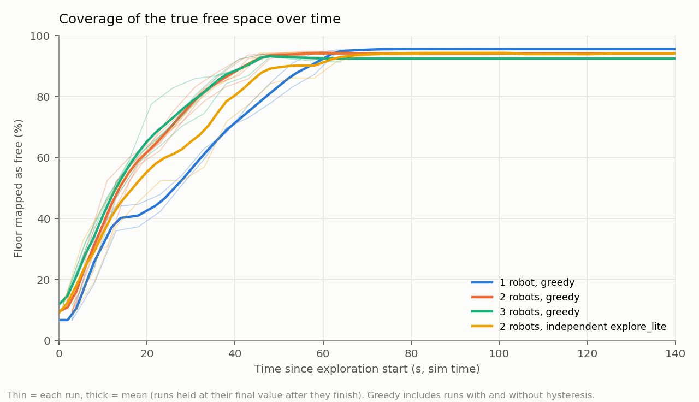
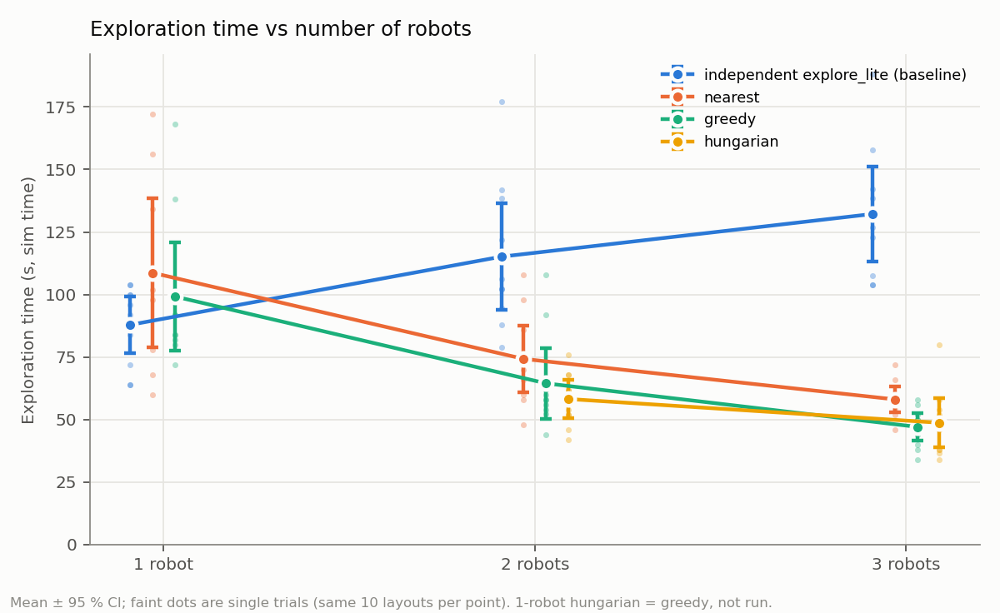
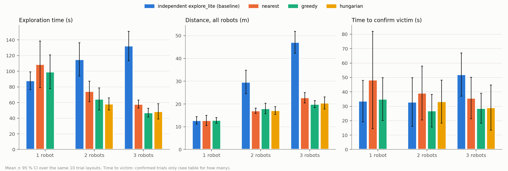
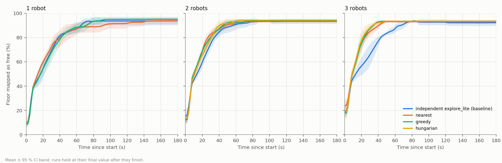
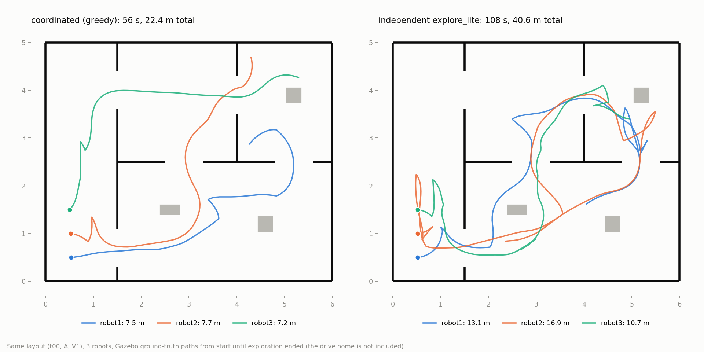
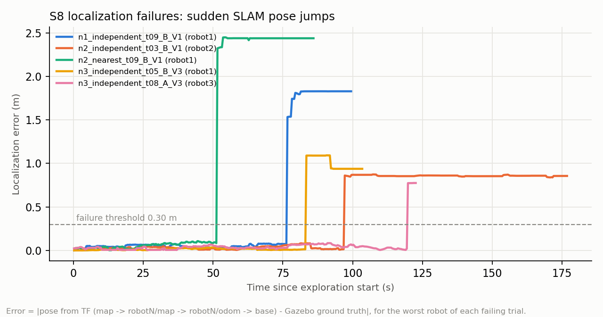
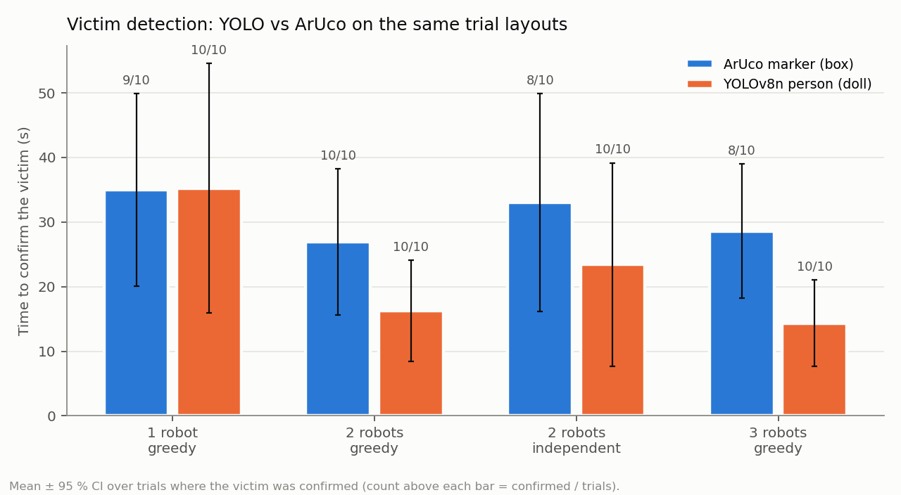

# Multirover: simulation results (S0–S8, S7b YOLO)

Report-ready results for the simulation phase, collected on 2026-09-26. Everything here is
either copied from `../results/` (the raw folder every run writes to automatically) or
regenerated from it:

```bash
cd ~/Desktop/multirover && python3 result/make_result.py
```

Re-run that after new experiments (S8). New runs in `results/s5/` and `results/s6/` are picked
up automatically. Runs in `results/excluded/` are left out, with the reason written there.



**Setup** (exact versions in `setup/versions.txt`): ROS 2 Jazzy, Gazebo Harmonic (headless, real-time factor 1.0, NVIDIA RTX 4070),
slam_toolbox, robot_localization EKF, Nav2 (Smac 2D + Regulated Pure Pursuit). The arena is
6 × 5 m: a hall, 3 rooms, 0.8 m doors, 2 loops and 3 box obstacles. The robot is a 2-wheel
differential drive with a 2D lidar (10 Hz), IMU and camera. All times are simulation seconds.

## Where everything is

**In this folder (`result/`), ready for the report:**

| Path | What it is |
|---|---|
| `README.md` | This file: key numbers, findings and caveats for every step |
| `tables/summary_by_config.md` / `.csv`, `tables/all_runs.csv` | S5/S6 runs |
| `tables/victim_missions.md` / `.csv` | S7 victim missions |
| `tables/s8_summary.md` / `.csv`, `s8_speedups.csv`, `s8_all_trials.csv` | S8 campaign: per condition, paired speed-ups, every trial |
| `tables/s7b_yolo_vs_aruco.md` / `.csv` | S7b: YOLO vs ArUco victim detection on the same layouts |
| `figures/arena.png` | Method figure: floor plan, start sets A/B, victims V1–V3 |
| `figures/exploration_time_by_config.png`, `distance_by_config.png`, `coverage_vs_time.png` | S5/S6 |
| `figures/s4_nav_check_trajectories.png` | S4: goal, detour around a spawned box, unreachable goal |
| `figures/s8/time_vs_robots.png` | S8 headline: exploration time vs robots, per strategy |
| `figures/s8/strategy_comparison.png` | S8: time, distance, time to victim |
| `figures/s8/coverage_curves.png` | S8: coverage over time, 1/2/3 robots |
| `figures/s8/trajectories_n3.png` | S8: coordinated vs independent paths, same layout (the overlap finding) |
| `figures/s8/localization_failures.png` | S8: the 5 localization failures (sudden SLAM jumps) |
| `figures/s8/yolo_vs_aruco.png` | S7b: time to confirm the victim, YOLO vs ArUco |
| `figures/maps/` | Map-vs-ground-truth overlays: S3, S5, S6, `s7/`, `s8/` (all 110). Black = true walls, red = mapped walls near a true wall, orange = mapped walls that aren't, blue = mapped free space |
| `validation/` | The tests behind specific claims (merge, coordinator, ArUco accuracy offline and in Gazebo, the S4 costmap bug), with their results |
| `setup/versions.txt`, `setup/config/`, `setup/README.md` | Machine and package versions, the configs used, the commands to reproduce each step |
| `data/s4/` | The S4 trajectory data and its plotting script |
| `make_result.py`, `s8_analysis.py`, `report_figures.py`, `loc_error.py` | Rebuild all of `tables/` and `figures/`: `python3 result/make_result.py` |

**Raw data (`../results/`)**, which the tables are computed from:
- `s5/`, `s6/`, `s7/`, `pilot/`, `s8/<tag>/`: one folder per run, each with:
  - `summary.yaml`, `coverage.csv`, `map.pgm/.yaml`, `map_vs_gt.png`
  - S8 also: `trajectories.csv`, `trial_plan.yaml`, `loc_error.yaml`, `bag/` (zstd MCAP)
  - ROS bags are available through the [dataset download](../datasets/README.md); runtime logs are omitted.
- `excluded/`: runs left out, with the reason

**Code:** `../src/` (the patch to the cloned explore_lite is also in `setup/config/`).

## Key results by step

### S2: simulated robot and sensors
- **Odometry check** (against Gazebo ground truth): a 1 m straight drive has 0.08 % error, and a 360° spin has 1.9° error.
- **Bug fixed along the way:** the wheel collision shape made spins over-rotate by 54°.
- **Sensor rates:** lidar 10 Hz, IMU 95 Hz, odometry 29 Hz, camera 14–15 Hz.

### S3: sensor fusion (EKF) and SLAM
- **Five in-place spins,** yaw error against ground truth. The simulated wheel odometry has realistic noise and a 4 % over-rotation added:

  | Source | Yaw error |
  |---|---|
  | Wheel odometry alone | **+72.1°** |
  | EKF (wheel + IMU) | **−0.02°** |

- **Map from a 34 m scripted tour** (`figures/maps/s3_floor_v1_tour_vs_gt.png`), scored against the ground truth:

  | Metric | Result |
  |---|---|
  | Wall precision | 100 % |
  | Wall recall | 100 % |
  | Free-space coverage | 95.2 % |

  Took 300 s.

### S4: point-to-point navigation (Nav2)
Scored on Gazebo ground truth while SLAM runs. All four tests pass in every run after the fixes (4 runs; `figures/s4_nav_check_trajectories.png`):

| Test | Result |
|---|---|
| Goal through a door | Reached, final error 0.10 m, 0 recoveries |
| 0.3 m box spawned 0.8 m ahead on the path | Replanned around it, 0.21 m minimum clearance, 0 recoveries, 19 s |
| Goal off the map | Rejected at once (correct) |
| Goal inside an obstacle | 15–17 recovery attempts, then gave up (correct); never closer than 0.37 m |

Important fix: the costmap obstacle layers had been silently getting **no lidar data**, because of Jazzy's relative-topic rule. Before the fix, a spawned box caused 8 recoveries and a 1.5 cm near-collision.

### S5: single-robot autonomous exploration (explore_lite)
6 runs, one launch command, no human input:

| Metric | Result |
|---|---|
| Exploration time | **86.5 ± 17.3 s** (60–112) |
| Distance driven | 12.2 m |
| Coverage | 95.3 % |
| Wall recall | 99.2 % |

For comparison, the S3 hand-scripted tour took 300 s and 34 m for the same coverage. Coverage levels off at about 95 %: the cells right against walls and the shadows behind boxes can't be mapped as free, and the scripted tour hits the same ceiling.

### S6: multi-robot exploration with the frontier coordinator



| Robots | Strategy | Runs | Time mean ± sd (s) | Min–max (s) | Time to 99 % of final coverage (s) | Distance (m) | Coverage | Wall recall |
|---|---|---|---|---|---|---|---|---|
| 1 | explore_lite (S5) | 6 | 86.5 ± 17.3 | 60–112 | 69.6 | 12.2 | 95.3 % | 99.2 % |
| 1 | greedy | 2 | 73.0 ± 7.1 | 68–78 | 65.5 | 11.6 | 95.6 % | 99.6 % |
| 2 | greedy | 3 | 61.3 ± 5.1 | 56–66 | 50.7 | 17.9 | 94.4 % | 99.8 % |
| 2 | greedy + hysteresis | 3 | 56.2 ± 5.7 | 51–62 | 47.3 | 17.1 | 94.0 % | 100.0 % |
| 2 | hungarian | 1 | 66.0 | 66–66 | 48.0 | 19.4 | 93.6 % | 100.0 % |
| 2 | hungarian + hysteresis | 1 | 58.0 | 58–58 | 51.0 | 17.8 | 93.5 % | 100.0 % |
| 2 | nearest | 1 | 66.0 | 66–66 | 61.0 | 16.4 | 94.4 % | 99.6 % |
| 2 | **independent explore_lite** (baseline) | 2 | **116.6 ± 19.6** | 103–130 | 56.8 | 28.5 | 94.2 % | 99.8 % |
| 3 | greedy | 2 | 58.0 ± 2.8 | 56–60 | 43.5 | 23.2 | 93.0 % | 99.8 % |
| 3 | greedy + hysteresis | 2 | 57.0 ± 10.0 | 50–64 | 47.0 | 24.9 | 92.1 % | 100.0 % |



**Findings:**
1. **Coordination is essential.** Two uncoordinated explore_lite robots are *slower than one
   robot* (117 s against 73–87 s) and drive 2.3× the distance. Each robot plans on its own map, so
   it keeps chasing frontiers the other robot already mapped. In the coverage plot the
   uncoordinated pair reaches 90 % almost as early as the coordinated one; almost all the lost
   time is in the tail.
2. **Two coordinated robots beat one.** 2 robots with greedy take 56–61 s, against 73 s for one
   robot with the same pipeline, which is about 20–25 % faster.
3. **A third robot adds nothing in this arena** (57–58 s). The floor is small (6 × 5 m), so
   three robots mostly get in each other's way.
4. **Hysteresis** (a bonus for keeping the current target) stops robots being re-sent back and
   forth between near-equal frontiers. It barely changes the mean time. Hungarian and nearest
   have one run each, which is too few to rank the strategies. That's S8's job.
5. **Merge quality drops with more robots.** The merge rule is "occupied beats free", so every
   robot's slightly drifted copy of a wall survives and walls get thicker. Coverage falls from
   about 95 % with one robot to 92–93 % with three, while wall precision stays at about 100 %.
   Compare `figures/maps/s6_3robot_greedy_plus_hysteresis_*_gh3b.png` with a 1-robot map.

**Likely limit on speed-up:** slam_toolbox publishes its map every 5 s, so the coordinator
plans on a map up to 6 s old. That delays both reassignment and the "done" decision
(time to 99 % coverage is about 47 s, the finish about 56 s for 2 robots). This is a candidate
for S8.

### S7: victim detection (ArUco) and the victim mission
The victim is a 0.2 m box with a 0.10 m ArUco marker (DICT_4X4_50, id 0) at (3.0, 4.75),
facing into room C. Missions use 2-robot greedy unless noted
(`tables/victim_missions.md`).

**Detection accuracy on the real Gazebo camera** (single robot placed at a known pose):

| Robot position | Error |
|---|---|
| 1.2 m, straight on | 1.8 cm |
| 1.8 m, straight on | 4.3 cm |
| 2.0 m, straight on | 8 cm |
| 1.5 m, 40° off-axis | 4.4 cm |

The marker is detected in every frame at all four positions. Detections beyond 2.0 m aren't counted.

**Missions:** every one found and confirmed the victim, with **3.3–6.8 cm** error (target < 15 cm):

| Robots | Stops at victim | Time to confirm | Error at confirm | Coverage when it stopped |
|---|---|---|---|---|
| 1 | yes | 30.9 s | 6.8 cm | 76 % |
| 2 | yes | 24.9 / 32.7 / 33.4 s | 6.5 / 5.7 / 4.5 cm | 76–83 % |
| 3 | yes | 34.5 s | 3.3 cm | 86 % |
| 2 | no (explores everything) | 52.0 s (done at 82 s) | 3.8 cm | 93 % |

**Design point for the report: investigating sightings.** Frontier exploration alone
mapped the whole floor without ever confirming the victim, because no camera came within
2 m facing the marker. Now any sighting up to 4 m sends the nearest robot to a viewpoint
1.2 m in front of the marker, and it's confirmed within seconds.

### S8: experiment campaign (110 trials)
**Design.**
- **Conditions:** 11 in total, robots ∈ {1, 2, 3} × strategy ∈ {independent explore_lite (baseline), nearest, greedy, hungarian}. With one robot, hungarian equals greedy, so it isn't run.
- **Trials:** 10 per condition, **the same 10 layouts for every condition** (paired). There are 2 start sets (A: hall, B: room B) and 3 victim positions (V1: room C, V2: room D, V3: hall), rotated as trial t → start `[A, B][t % 2]`, victim `[V1, V2, V3][t % 3]`.
- **Every trial explores the whole floor** (`stop_on_victim: false`), so exploration time and time-to-victim are both measured.
- **Recorded per trial:** a zstd MCAP bag (939 MB for the whole campaign), the saved map and its overlay, coverage over time, ground-truth trajectories, and localization error (from the bag).
- **Tables:** `tables/s8_summary.md` / `s8_summary.csv` / `s8_speedups.csv` / `s8_all_trials.csv`.
- **Figures:** `figures/s8/`.



| Robots | Strategy | Exploration time (s) | Paired speed-up vs 1 robot | Distance (m) | Overlap | Victim found | Localization failures |
|---|---|---|---|---|---|---|---|
| 1 | independent explore_lite | 87.8 ± 11.4 | – | 12.8 | – | 9/10 | 1/10 |
| 1 | nearest | 108.7 ± 29.8 (1 stalled) | – | 12.8 | – | 8/10 | 0/10 |
| 1 | greedy | 99.2 ± 21.6 | – | 12.8 | – | 9/10 | 0/10 |
| 2 | independent explore_lite | 115.1 ± 21.4 | **0.79×** | 29.6 | 37 % | 8/10 | 1/10 |
| 2 | nearest | 74.2 ± 13.2 | 1.61× | 17.0 | 6 % | 10/10 | 1/10 |
| 2 | greedy | 64.4 ± 14.1 | 1.67× | 18.0 | 11 % | 10/10 | 0/10 |
| 2 | hungarian | **58.2 ± 7.7** | **1.79×** | 17.2 | 7 % | 10/10 | 0/10 |
| 3 | independent explore_lite | 132.2 ± 18.9 | **0.67×** | 47.1 | 44 % | 10/10 | 2/10 |
| 3 | nearest | 58.0 ± 5.2 | 1.96× | 22.8 | 7 % | 9/10 | 0/10 |
| 3 | greedy | **47.0 ± 5.6** | **2.18×** | 19.9 | 10 % | 8/10 | 0/10 |
| 3 | hungarian | 48.6 ± 9.9 | 2.17× | 20.4 | 9 % | 9/10 | 0/10 |

Mean ± 95 % CI over the completed trials. The speed-up compares each trial with the 1-robot
trial of the same strategy on the same layout (greedy for hungarian). The full table (coverage,
wall F1, free IoU, time to victim, victim error) is in `tables/s8_summary.md`.






**Findings:**
1. **Coordination makes more robots faster; without it, more robots are slower.** Coordinated
   exploration takes 1.7–1.8× less time with 2 robots and 2.0–2.2× less with 3 (99 → 47 s for
   greedy). Independent explore_lite gets *slower* with each robot added: 88 → 115 → 132 s,
   0.79× and 0.67×. It drives 2.3× (2 robots) and 3.7× (3 robots) the single-robot distance,
   against 1.4× and 1.6× for greedy. The robots retrace each other's paths: 37–44 % of visited
   cells are visited by more than one robot, against 6–11 % with coordination.
2. **Among the coordinated strategies, the differences are small compared with the spread.**
   hungarian is best with 2 robots (58 s), greedy and hungarian tie with 3 (47–49 s), and nearest
   is about 9–16 s slower in both. Most 95 % intervals overlap, so rank greedy and hungarian
   as equivalent here, both ahead of nearest.
3. **The coordinator does not beat explore_lite with a single robot** (greedy 99 s against
   explore_lite 88 s; the intervals overlap). Its gain comes from coordination, not from better
   single-robot frontier choice. It is also slowed by stopping to investigate victim sightings,
   which explore_lite doesn't do.
4. **Map quality is the same with and without coordination**, except when localization fails.
   Coordinated runs keep wall F1 at 97.5–99.9 % and free IoU at 92.7–95.0 % at every robot count.
   The independent means are lower (94.6–96.9 %) because of 4 localization failures.
5. **Localization failures: 5 of 110 trials** (a robot more than 0.3 m off at some point). 4 of
   them are in the 30 independent trials and 1 in the 80 coordinated ones. Each is a sudden
   0.8–2.4 m jump in slam_toolbox's pose, a false loop closure: in the worst case the pose leapt
   from the hall to room C, which looks similar. They cause the low wall F1 outliers (54–82 %).
   A plausible reason the baseline suffers more, not proven: its runs are longer and revisit
   much more, so there are more chances for a wrong loop closure. Otherwise the robots stay well
   localized: the median of each trial's worst error is 7–11 cm.
6. **Victim: 100 of 110 trials confirmed it, all with ≤ 9.8 cm error** (mean 3.5–7.5 cm per
   condition; target < 15 cm). 8 of the 10 misses are the same layout, V3 with start A: the
   victim is on the hall's west wall, behind robots that start in the hall facing east. The
   lidar maps the hall in seconds, so exploration never turns a camera back towards that wall.
   In one of them the victim was confirmed only on the drive home, after exploration had ended.
   **Lidar coverage is not camera coverage.** Camera-aware exploration or view planning is
   future work.
7. **Not completed: 1 of 110 trials**, n1_nearest_t03 ("stalled"): the robot was pinned between a
   box and a wall, where Nav2 refused spin and back-up recoveries as collisions. A second stalled
   trial was a coordinator deadlock. It was fixed during the campaign and re-run, and the
   original is in `../results/excluded/`.

**Campaign fixes:**
- explore_lite could loop forever on a frontier that can't be cleared (patched: blacklist a
  frontier still there 5 s after it was reached), and the coordinator got the same rule.
- The coordinator now finishes when the remaining frontiers stay unreachable for 15 s (applied
  from trial 61 on; earlier trials never reached that state).
- The monitor ends a trial as "stalled" after 120 s without coverage gain and 60 s without
  robot motion.
- slam_toolbox publishes its map every 1 s (5 s before S8).
- Maps are scored against the ground truth with the victim box where the trial put it.

### S7b: YOLO person detection vs ArUco (40 + 35 paired trials)
**Setup.**
- **Victim:** a seated person model, "Rescue Randy Sitting" (OpenRobotics, CC0; the DARPA SubT
  victim mannequin), scaled to a 0.29 m doll (`src/mrs_gazebo/scripts/make_victim_person.py`).
- **Detector:** YOLOv8n (COCO "person", confidence ≥ 0.5, 5 Hz per robot, RTX 4070). The
  direction comes from the box centre; the distance is the nearest lidar cluster inside the box,
  cross-checked with the box height (`src/mrs_perception/mrs_perception/yolo_victim_node.py`,
  run from the project venv).
- **Campaign:** the same 10 S8 layouts for 1/2/3 robots with greedy, plus the 2-robot independent
  baseline, each explored fully, compared trial by trial with the ArUco runs of S8. The doll
  is placed 0.105 m further from the wall than the ArUco box, so its back is where the box's back was.
- **Table:** `tables/s7b_yolo_vs_aruco.md` (per condition and per victim position).
- **Figure:** `figures/s8/yolo_vs_aruco.png`.



**Detection range in Gazebo** (one robot, the doll straight ahead): detected in every frame from
0.8 to 4.0 m (confidence 0.77–0.94). Ranged within about 10 cm from the front, side and back
(`validation/yolo_gazebo_test.sh`). ArUco only counts detections within 2 m.

| Robots | Strategy | Victim found ArUco / YOLO | Time to confirm ArUco / YOLO (s) | Paired time saved by YOLO (s) | Error mean / max ArUco (cm) | Error mean / max YOLO (cm) |
|---|---|---|---|---|---|---|
| 1 | greedy | 9/10 / **10/10** | 35.0 / 35.3 | 5.8 ± 4.8 | 5.6 / 8.0 | 6.7 / 9.2 |
| 2 | greedy | 10/10 / 10/10 | 26.9 / **16.3** | 10.6 ± 11.3 | 4.8 / 8.6 | 7.5 / 15.3 |
| 2 | independent explore_lite | 8/10 / **10/10** | 33.0 / **23.4** | 11.1 ± 16.5 | 5.1 / 9.8 | 5.3 / 9.2 |
| 3 | greedy | 8/10 / **10/10** | 28.6 / **14.3** | 11.8 ± 13.1 | 3.5 / 6.0 | 9.3 / 17.6 |

**Findings:**
1. **YOLO confirmed the victim in all 40 trials;** ArUco managed 35 of the same 40 layouts. The
   ArUco misses were mostly V3, the victim behind robots that start facing away. YOLO sees the
   larger person from up to 4 m as the robots make their first turns, so the "camera never looks
   back" problem from S8 disappears in these layouts.
2. **With 2–3 robots YOLO confirms the victim about 10–12 s earlier** (paired means; 16 s against
   27 s with 2 greedy robots, 14 s against 29 s with 3). Often no investigation trip is needed.
   With one robot there is no difference (35 s each).
3. **ArUco is more precise.** Its mean error is 3.5–5.6 cm, against 5.3–9.3 cm for YOLO. YOLO
   stays within 10 cm at V1 and V2, but at V3 with 2–3 robots its worst errors are 15.3 and
   17.6 cm, just over the 15 cm target. The robots see that doll side-on or from behind at
   steep angles, where the lidar-to-centre offset is least accurate. Ideas: use hits from
   closer range only, or estimate the doll's orientation.
4. **Limits of the comparison:** it compares two victim *systems* (box + ArUco vs doll + YOLO), not
   just two detectors. The doll is bigger, easier to see and 0.105 m further from the wall.
   Time and detection rate reflect both the detector and the target.
5. **One of 40 YOLO trials stalled** (1 robot, t01): the robot got pinned between room D's box,
   the doll and the wall. This is the same kind of cornered-robot event as in S8, made more
   likely by the bigger victim.
6. **Why the first YOLO campaign was discarded:** the doll first sat at the box's centre points,
   so at V2/V3 its back half was inside the wall (errors up to 28 cm). Those 25 trials are in
   `../results/excluded/`.

## Caveats (state these in the report)
- **Sample sizes:** S5–S7 have 1–6 runs per configuration (all robots starting in the hall).
  S8 has 10 paired trials per condition, 2 start sets and 3 victim positions, but still **one
  arena**. The results may not carry over to larger or differently shaped floors.
- **Settings differ between steps:** S5–S7 used a 5 s SLAM map update and no victim
  investigation in S5/S6, while S8 used 1 s and investigation on. Compare numbers within a step,
  not across steps.
- **Excluded run:** one 2-robot run (42 s) is left out because it started on a stale,
  almost-complete map from a leftover process. See `../results/excluded/README.md`. Earlier
  summaries quoted 56.5 s for "2 robots, greedy", which included that run; the
  corrected value is 61.3 s.
- **Two versions of greedy and hungarian:** runs tagged `gh*`/`hh*` have hysteresis 2.0,
  earlier runs have none. The "no two robots on one frontier" rule applies to all runs listed
  here.
- **Coverage definition:** the share of the ground-truth free cells (0.05 m grid) that the map
  marks free. Wall precision is the share of mapped wall cells within 0.10 m of a true wall;
  wall recall is the share of true wall cells within 0.10 m of a mapped wall.
- **The 1-robot configurations differ in more than the explorer:** S5 (explore_lite) plans on
  the robot's own SLAM map, while the S6 coordinator runs plan on the merged map.

## Still to do for the report
- S4/S5/S6 GUI runs to watch, and the S6 screen recording
  (`ros2 launch mrs_exploration sim_multi_robot.launch.py n:=2 strategy:=greedy`).
- Hardware (the real robots) comes next; see sim_plan.md §12.
